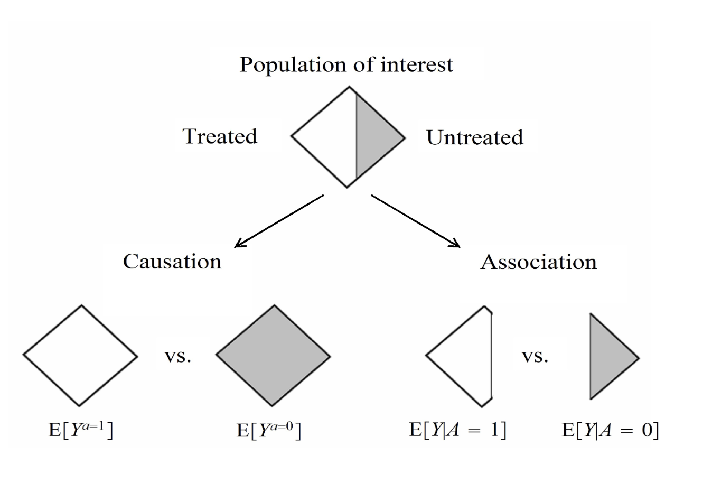
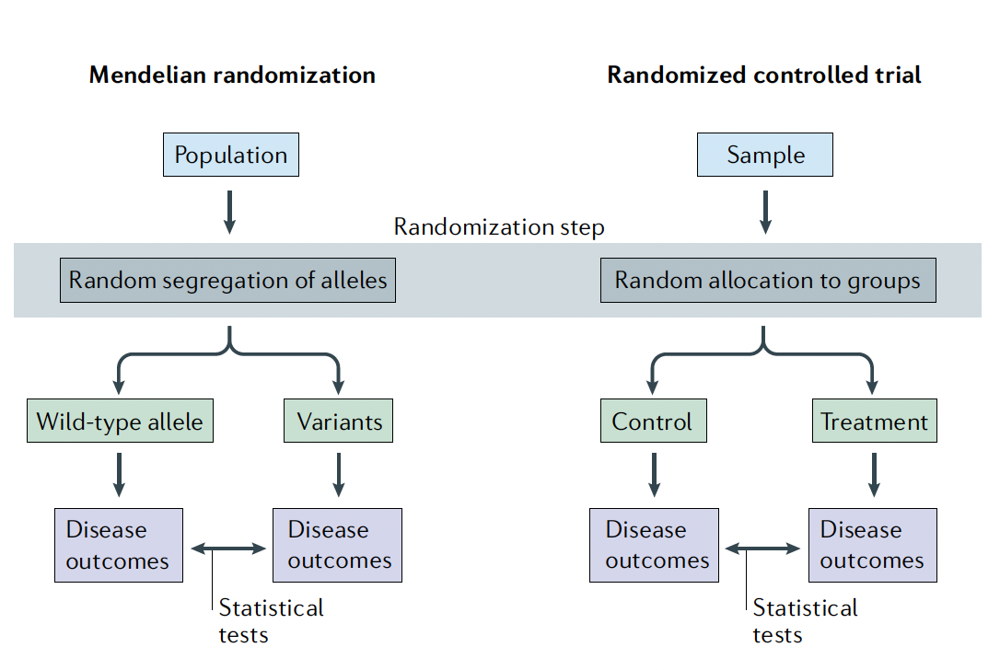

```{r}
#| label: libraries
#| echo: false
#| message: false

library(ggplot2)
library(cmdstanr)
library(dplyr)
library(mvtnorm)
library(tidyr)
theme_set(theme_minimal(base_family = "NewComputerModernSans10"))
theme_update(panel.grid = element_blank())
```

## Motivation

- One major goal of epidemiology is to identify modifiable causes of health outcomes and disease [@celentanoGordisEpidemiology2019]

- To enact interventions/treatment on some trait, we first want evidence that the trait **causes** the outcome of interest

## Difference between causation and association

::: {.columns}

:::: {.column width="35%"}
Consider

- Treatment $A$, where $A = \begin{cases} 1 \, \text{if treated} \\ 0 \, \text{if untreated}\end{cases}$

- Outcome $Y$, where $Y = \begin{cases} 1 \, \text{if death} \\ 0 \, \text{if survival}\end{cases}$

- $Y^{a=i}$ is the outcome that would have been observed under the treatment $a = i$

::::

:::: {.column width="65%"}



::::

:::

## One solution: Randomization


### Exchangeability

$$
Y^a \perp A \text{ for all } a \implies \mathrm{Pr}[Y^a = 1 | A = 1] = \mathrm{Pr}[Y^a = 1 | A = 0]
$$

- Or, independence between the counterfactual outcome and the observed treatment

- When group membership is randomized, in an ideal RCT, the groups are exchangeable

- Furthermore, this implies that $\operatorname{E}[Y^a | A = a'] = \operatorname{E}[Y^a]$

## Randomization is often not possible

- Let's say a researcher wants to estimate the causal effect of smoking ($A$) on lung health ($Y$)

- We can't conduct an RCT experiment on the general population here

- Let $U$ be common causes of $A$ and $Y$ (risk preferences, SES, environment)

- Note that $\mathrm{Pr}[Y^a = 1 \mid A=a] = \sum_{u} \mathrm{Pr}[Y^a = 1 \mid U=u, A=a] \mathrm{Pr}[U=u \mid A=a]$

- If $\mathrm{Pr}(U | A = 1) \neq \mathrm{Pr}(U | A = 0)$, then we do not have exchangeability

## A genetic solution? 

- However, we can use Mendelian randomization: the distribution of alleles/genes ($G$) is set at conception and is approximately random.

- Think of $G$ as an as‑if randomized assignment that nudges smoking ($X$)
  - We can compare lung health ($Y$) across $G$ groups much like RCT arms, scaled by the $G$‑induced difference in $X$

- After adjusting for ancestry/population structure ($A$), $G$ should be independent of typical confounders ($U$)

## MR compared to RCT

{height=80%}

## How MR approximates exchangeability

- Use genotype $G$ as an as‑if randomized assignment determined at conception.

- Key approximation: for each $a \in \{0,1\}$, $Y^a \perp G$ (often taken conditional on ancestry/population structure), so $\operatorname{E}[Y^a\,|\,G] = \operatorname{E}[Y^a]$.

- Timing: the “assignment” ($G$) happens at conception; effects reflect long‑run exposure differences rather than acute treatment.

- Noncompliance: $G$ only shifts $X$; not everyone changes behavior. MR targets the effect among those whose $X$ is moved by $G$ (a complier‑type estimand).

- This mirrors RCT exchangeability, replacing randomized $A$ with (approximately) randomized $G$.

\

\hrule

A more rigorous treatment of concepts in RCT can be found in @evansFundamentalConceptsClinical2021


## Instrumental Variables

::: {.block}

### Definition

An **instrument** is a variable that predicts the exposure, but conditional on the exposure shows no independent association with the outcome [@lousdalIntroductionInstrumentalVariable2018]

:::

- Again, consider estimating the causal effect of smoking ($A$) on lung health ($Y$)

- Let $U$ be common causes of $A$ and $Y$

- Consider an instrument $Z$, recorded tobacco tax levels

## Tobacco tax $\to$ Smoking $\to$ Lung health

```{mermaid}
%%| echo: false
%%| fig-width: 5.5
---
config:
  theme: default
  themeVariables:
    fontSize: 24
    fontFamily: NewComputerModernSans10
---
graph LR
  Z["Tobacco tax (Z)"] --> X["Smoking (X)"]
  X --> Y["Lung health (Y)"]
  U["Unobserved confounders (U)"] -.-> X
  U -.-> Y

  %% styling for unobserved node
  classDef unobs fill:#f9f9f9,stroke:#999,color:#555,stroke-dasharray: 5 5;
  class U unobs;
```

## IV DAG

Examples of confounders

- $X \to Y$ confounders ($U$): socioeconomic status, occupational exposures, ambient air pollution, household/peer smoking, mental health and risk preferences, access to healthcare and preventive care, baseline respiratory conditions.

- $Z \to Y$ threats: smoke-free laws and anti-smoking campaigns, healthcare policy intensity, or regional socioeconomic trends that correlate with both tobacco taxes and lung health.


## SNP $\to$ Smoking $\to$ Lung health

```{mermaid}
%%| echo: false
%%| fig-width: 5.5
---
config:
  theme: default
  themeVariables:
    fontFamily: NewComputerModernSans10
    fontSize: 30
---
graph LR
  G["Smoking-associated SNP (G)"] --> X["Smoking (X)"]
  X --> Y["Lung health (Y)"]
  U["Unobserved confounders (U)"] -.-> X
  U -.-> Y
  A["Ancestry / Population structure (A)"] -.-> G
  A -.-> Y

  classDef unobs fill:#f9f9f9,stroke:#999,color:#555,stroke-dasharray: 5 5;
  class U,A unobs;
```


## Mendelian randomization: SNP → Smoking → Lung health

Examples of confounders

- $X \to Y$ confounders ($U$): socioeconomic status, occupational exposures, ambient air pollution, household/peer smoking, mental health and risk preferences, access to healthcare and preventive care, baseline respiratory conditions.

- Population structure ($A$): ancestry differences, recruitment center/region, or subtle structure that links allele frequencies and lung health via environmental or clinical differences.

- $G \to Y$ threats: horizontal pleiotropy (genetic effects on lung health not via smoking), dynastic effects/assortative mating.

## IV Conditions

In order for the instrument to provide a valid test of the null hypotehsis that the exposure has no effect on the outcome, certain conditions must hold [@didelezAssumptionsIVMethods2010]:

### 1. Relevance

The IV must be associated with the exposure

### 2. Exchangeability

There are no causes of the IV that also influence the outcome through mechanisms other than the exposure of interest

### 3. The Exclusion Restriction

The IV does not affect the outcome other than through the exposure and does not affect any other trait that has a downstream effect on the outcome of interest.

## IV Conditions

### 1. Relevance

The IV must be associated with the exposure

```{mermaid}
%%| echo: false
%%| fig-width: 5.5
---
config:
  theme: default
  themeVariables:
    fontFamily: NewComputerModernSans10
    fontSize: 16
---
graph LR
  U --> Y
  U --> X
  G --> X
  X --> Y

  %% edge indices: 0 U->Y, 1 U->X, 2 G->X, 3 X->Y
  linkStyle 2 stroke:#1B1BDE,stroke-width:2px
```

## IV Conditions

### 2. Exchangeability

There are no causes of the IV that also influence the outcome through mechanisms other than the exposure of interest


```{mermaid}
%%| echo: false
%%| fig-width: 5.5
---
config:
  theme: default
  themeVariables:
    fontFamily: NewComputerModernSans10
    fontSize: 16
---
graph LR
  U --> Y
  G --> X
  U -.-> G
  X --> Y

  linkStyle 2 stroke:#1B1BDE,stroke-width:2px
```

## IV Conditions

### 3. The Exclusion Restriction

The IV does not affect the outcome other than through the exposure and does not affect any other trait that has a downstream effect on the outcome of interest.

```{mermaid}
%%| echo: false
%%| fig-width: 5.5
---
config:
  theme: default
  themeVariables:
    fontFamily: NewComputerModernSans10
    fontSize: 16
---
graph LR
  G --> X
  X --> Y
  G -.-> Y

  linkStyle 2 stroke:#1B1BDE,stroke-width:2px
```

## IV Conditions

1. Relevance
2. Exchangeability
3. The Exclusion Restriction

Only the first condition can be formally tested. The other two conditions can be disproved and otherwise assessed through a range of sensitivity analyses, but cannot be demonstrated to be true

\

\hrule


For a deeper look into IV methods in Biostatistics, see @hernanCausalInferenceWhat2025, @baiocchiInstrumentalVariableMethods2014, and @rubinInstrumentalVariablesAnalysis2015

## Assessing IV Conditions

### 1. Relevance

- The strength of the instrument can be assessed through the an F-statistic from the regression of the exposure on the instrument
- A common rule of thumb is that an F-statistic $> 10$ indicates a sufficiently strong instrument [@staigerInstrumentalVariablesRegression1997]

## Assessing IV Conditions

### 2. Exchangeability 

- Confounding of the genetic variants with the outcome can occur due to population structure, assortative mating, or dynastic effects
- Common approaches to mitigate these issues include adjusting for principal components of ancestry, restricting to unrelated individuals, and within-family study designs [@daviesFamilyMendelianRandomization2019]

## Assessing IV Conditions

### 3. Exclusion Restriction

- Violations can occur due to pleiotropy, where a genetic variant influences multiple traits
- Violations can occur due to linkage disequilibrium

## Assessing IV Conditions 

::: {.columns}

:::: {.column width="60%"}

### Horizontal Pleiotropy
```{mermaid}
%%| echo: false
%%| fig-width: 3.25
---
config:
  theme: default
  themeVariables:
    fontFamily: NewComputerModernSans10
    fontSize: 16
---
graph LR
  U --> X
  U --> Y
  G --> X --> Y
  G --> C --> Y
```

::::

:::: {.column width="40%"}

### Key

- $\fbox{G}:$ Genetic variant
- $\fbox{X}:$ Exposure of interest
- $\fbox{Y}:$ Outcome of interest
- $\fbox{U}:$ unmeasured confounder
- $\fbox{C}:$ unmeasured phenotype
::::

:::


## Assessing IV Conditions 

::: {.columns}

:::: {.column width="60%"}

### Horizontal Pleiotropy

```{mermaid}
%%| echo: false
%%| fig-width: 3.25
---
config:
  theme: default
  themeVariables:
    fontFamily: NewComputerModernSans10
    fontSize: 16
---
flowchart LR
  U --> Y
  U --> X
  G --> X --> Y
  G --> C
```

::::

:::: {.column width="40%"}

### Key

- $\fbox{G}:$ Genetic variant
- $\fbox{X}:$ Exposure of interest
- $\fbox{Y}:$ Outcome of interest
- $\fbox{U}:$ unmeasured confounder
- $\fbox{C}:$ unmeasured phenotype
::::

:::


## Assessing IV Conditions 

::: {.columns}

:::: {.column width="60%"}

### Linkage disequilibrium

```{mermaid}
%%| echo: false
%%| fig-width: 3.25
---
config:
  theme: default
  themeVariables:
    fontFamily: NewComputerModernSans10
    fontSize: 16
---
flowchart LR
  U --> Y
  U --> X
  G1 --> X --> Y
  G1 <--> G2
  G2 --> C
  C --> Y
```

::::

:::: {.column width="40%"}

### Key

- $\fbox{G}:$ Genetic variant
- $\fbox{X}:$ Exposure of interest
- $\fbox{Y}:$ Outcome of interest
- $\fbox{U}:$ unmeasured confounder
- $\fbox{C}:$ unmeasured phenotype
::::

:::

## Assessing IV Conditions

::: {.columns}

:::: {.column width="60%"}

### Linkage disequilibrium

```{mermaid}
%%| echo: false
%%| fig-width: 3.25
---
config:
  theme: default
  themeVariables:
    fontFamily: NewComputerModernSans10
    fontSize: 16
---
flowchart LR
  U --> Y
  U --> X
  G1 --> X --> Y
  G1 <--> G2
  G2 --> U
```

::::

:::: {.column width="40%"}

### Key

- $\fbox{G}:$ Genetic variant
- $\fbox{X}:$ Exposure of interest
- $\fbox{Y}:$ Outcome of interest
- $\fbox{U}:$ unmeasured confounder
::::

:::

## Assessing IV Conditions

::: {.columns}

:::: {.column width="60%"}

### Vertical Pleiotropy

```{mermaid}
%%| echo: false
%%| fig-width: 3.25
---
config:
  theme: default
  themeVariables:
    fontFamily: NewComputerModernSans10
    fontSize: 16
---
flowchart LR
  U --> Y
  U --> X
  G --> X --> C --> Y
```

::::

:::: {.column width="40%"}

### Key

- $\fbox{G}:$ Genetic variant
- $\fbox{X}:$ Exposure of interest
- $\fbox{Y}:$ Outcome of interest
- $\fbox{U}:$ unmeasured confounder
- $\fbox{C}:$ unmeasured phenotype
::::

:::

## Assessing IV Conditions 

::: {.columns}

:::: {.column width="60%"}

### Misspecification of the primary phenotype 
```{mermaid}
%%| echo: false
%%| fig-width: 3.25
---
config:
  theme: default
  themeVariables:
    fontFamily: NewComputerModernSans10
    fontSize: 16
---
flowchart LR
  U --> Y
  U --> X
  X --> Y
  G --> C --> Y
```

::::

:::: {.column width="40%"}

### Key

- $\fbox{G}:$ Genetic variant
- $\fbox{X}:$ Exposure of interest
- $\fbox{Y}:$ Outcome of interest
- $\fbox{U}:$ unmeasured confounder
- $\fbox{C}:$ unmeasured phenotype
::::

:::

## Assessing IV Conditions 

::: {.columns}

:::: {.column width="60%"}

### Correlated pleiotropy

```{mermaid}
%%| echo: false
%%| fig-width: 3.25
---
config:
  theme: default
  themeVariables:
    fontFamily: NewComputerModernSans10
    fontSize: 16
---
flowchart LR
  U --> Y
  U --> X
  X --> Y
  G --> C --> Y
  C --> X
```

::::

:::: {.column width="40%"}

### Key

- $\fbox{G}:$ Genetic variant
- $\fbox{X}:$ Exposure of interest
- $\fbox{Y}:$ Outcome of interest
- $\fbox{U}:$ unmeasured confounder
- $\fbox{C}:$ unmeasured phenotype
::::

:::

## Assessing IV Conditions

::: {.columns}

:::: {.column width="60%"}

### Population stratification

```{mermaid}
%%| echo: false
%%| fig-width: 3.25
---
config:
  theme: default
  themeVariables:
    fontFamily: NewComputerModernSans10
    fontSize: 16
---
flowchart LR
  U --> Y
  U --> X
  G --> X --> Y
  S --> G
  S --> U
```

::::

:::: {.column width="40%"}

### Key

- $\fbox{G}:$ Genetic variant
- $\fbox{X}:$ Exposure of interest
- $\fbox{Y}:$ Outcome of interest
- $\fbox{U}:$ unmeasured confounder
- $\fbox{S}:$ population structure/ancestry 
::::

:::


## Assessing IV Conditions

For a deeper dive into understanding directed acyclic graphs (DAGs) and causal inference, see @pearlCausalityModelsReasoning2022

## Point-estimate identifying conditions
- **IV1–IV3** are sufficient to test the **exact null** (no causal effect), **not** to identify a numeric effect size.  
- For a **point estimate**, add one of the following assumptions

### Homogeneity

Either

1. The effect of the exposure on the outcome is the same for all individuals (estimate is the causal effect of the exposure on the outcome)
2. The effect of the exposure on the outcome is independent of the value of the instrument (estimate is the population average causal effect)

### Monotonicity

The direction of the effect of the genetic variant on the exposure is the same for everyone 

## Two Stage Least Squares Estimation

### Stage One

- Let $X$ be the exposure of interest, $\mathbf{G}$ be a $n \times p$ matrix of genetic variants. We can then model

$$
X = \pi_0 + \mathbf{G}\mathbf{\pi} + v_x
$$

### Stage Two

- The outcome is then regressed upon the predicted value of the exposure, $\hat{X}$

$$
Y = \alpha + \beta \hat{X} + u
$$

Where $\hat{\beta}$ is a consistent estimator of the causal effect of $X$ on $Y$ if the IV assumptions hold [@wooldridgeEconometricAnalysisCross2010]

## TSLS Example

```{r}
#| echo: true
#| warning: false
#| message: false

set.seed(8878)
n <- 2000             # sample size
U <- rnorm(n)          # unobserved confounder
Z <- rbinom(n, 1, 0.5) # instrument
e_x <- rnorm(n)        # error term for X
e_y <- rnorm(n)        # error term for Y
```

## TSLS Example

```{r}
#| label: tsls-demo
#| echo: true
#| warning: false
#| message: false
beta_true <- 1.5 # causal effect of X on Y
theta     <- 0.8 # effect of Z on X (relevance)
alpha     <- 1.0 # effect of U on Y (confounding)
lambda    <- 0.9 # effect of U on X (confounding)
```

```{r}
X <- theta * Z + lambda * U + e_x         # exposure
Y <- beta_true * X + alpha * U + e_y      # outcome
df <- tibble(Y = Y, X = X, Z = Z, U = U)
```

## TSLS Example

```{r}
#| echo: true
#| warning: false
#| message: false
 
m_ols   <- lm(Y ~ X, data = df)   # OLS estimate

m_stage1 <- lm(X ~ Z, data = df)  # 1st stage: predict X from Z
Xhat <- fitted(m_stage1)          # predicted X from 1st stage

m_tsls <- lm(Y ~ Xhat, data = df) # 2nd stage: regress Y on Xhat

# First-stage strength (F-statistic on Z)
F1 <- unname(summary(m_stage1)$fstatistic[1])
```

## TSLS Example

```{r}
#| echo: false
#| warning: false
#| message: false
tibble("True beta" = beta_true,
       "OLS beta-hat" = coef(m_ols)["X"],
       "2SLS beta-hat" = coef(m_tsls)["Xhat"],
       "F" = F1) |>
       knitr::kable()
```

## TSLS Example

```{r}
#| label: tsls-plot
#| echo: false
#| warning: false
#| fig-width: 6
#| fig-height: 3.5

ggplot(df, aes(X, Y, color = factor(Z))) +
  geom_point(alpha = 0.35, size = 1) +
  geom_smooth(method = "lm", se = FALSE) +
  scale_color_manual(values = c("0" = "#999999", "1" = "#1f77b4"), name = "Z") +
  labs(x = "Exposure X", y = "Outcome Y", title = "Scatter with instrument strata (Z)") +
  theme(legend.position = "top")
```

```{r}
#| label: tsls-relevance-sim
#| echo: false
#| warning: false
#| message: false
#| cache: true

# Simulate how varying instrument relevance (theta: effect of Z on X)
# impacts TSLS estimates. Holds the DGP fixed except for theta.
set.seed(8878 + 1)
thetas <- seq(0.05, 1.6, length.out = 16)
R <- 250
n_sim <- 1000

# Re-declare structural parameters to avoid dependence on earlier chunks
beta_true <- 1.5
alpha     <- 1.0
lambda    <- 0.9

sim_one <- function(theta, n) {
  U <- rnorm(n)
  Z <- rbinom(n, 1, 0.5)
  e_x <- rnorm(n)
  e_y <- rnorm(n)
  X <- theta * Z + lambda * U + e_x
  Y <- beta_true * X + alpha * U + e_y
  m1 <- lm(X ~ Z)
  F1 <- unname(summary(m1)$fstatistic[1])
  Xhat <- fitted(m1)
  m2 <- lm(Y ~ Xhat)
  tsls <- unname(coef(m2)["Xhat"]) 
  ols  <- unname(coef(lm(Y ~ X))["X"]) 
  tibble(theta = theta, tsls = tsls, ols = ols, F = F1)
}

res <- replicate(
  R,
  bind_rows(lapply(thetas, function(th) sim_one(th, n_sim))),
  simplify = FALSE
) |> bind_rows()

sumres <- res |>
  group_by(theta) |>
  summarise(
    tsls_mean = mean(tsls),
    tsls_q025 = quantile(tsls, 0.025),
    tsls_q975 = quantile(tsls, 0.975),
    F_mean = mean(F),
    ols_mean = mean(ols),
    .groups = "drop"
  )
```


## TSLS across instrument strength

Ribbon: 2.5–97.5% across simulations; dashed = true beta; dotted = OLS mean

```{r}
#| label: tsls-relevance-plot
#| echo: false
#| warning: false
#| fig-width: 7
#| fig-height: 4

ggplot(sumres, aes(theta, tsls_mean)) +
  geom_ribbon(aes(x = theta, ymin = tsls_q025, ymax = tsls_q975), inherit.aes = FALSE,
              fill = "#1f77b4", alpha = 0.15) +
  geom_line(linewidth = 0.9) +
  geom_hline(yintercept = beta_true, linetype = "dashed", color = "black") +
  geom_line(aes(y = ols_mean), color = "#e41a1c", linetype = "dotted", linewidth = 0.8) +
  scale_color_gradient(name = "Mean first-stage F",
                       low = "#2c7bb6", high = "#d7191c") +
  labs(
    x = "Instrument relevance (theta: effect of Z on X)",
    y = "Estimated beta (TSLS)"
  ) +
  theme(legend.position = "right")
```


## References {.allowframebreaks}
